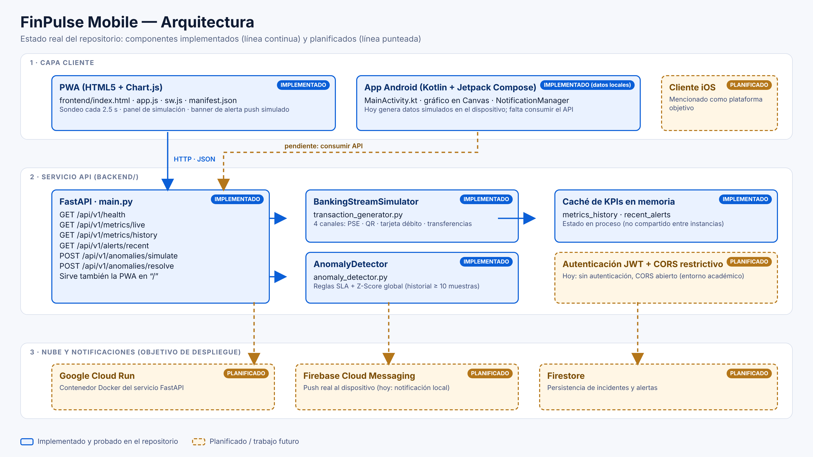
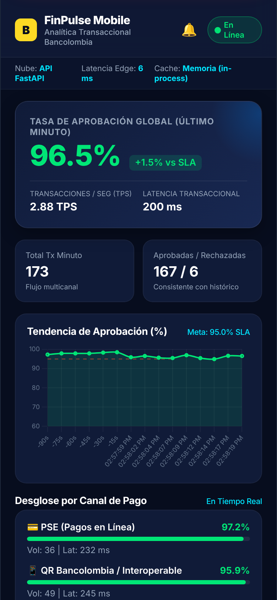
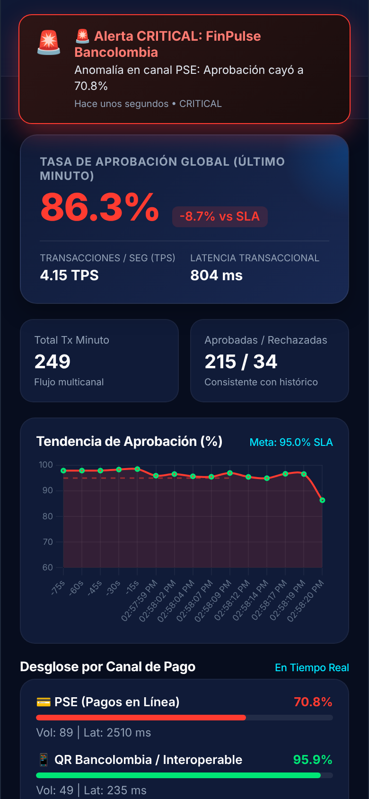
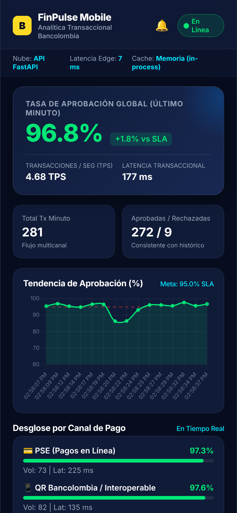
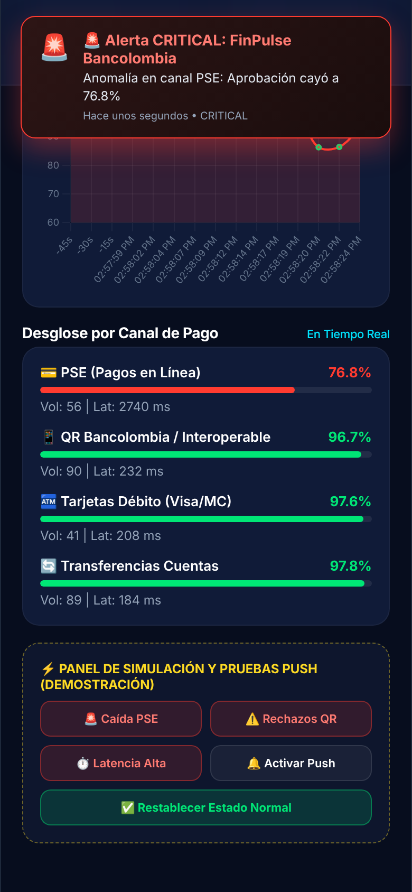

# FinPulse Mobile

**Monitoreo de KPIs transaccionales bancarios y alertas de anomalías en tiempo real**


**Autores:** Juan José Raigoza Calderón · Jorge Mario Vélez Osorio — Medellín, Colombia, 2026

FinPulse Mobile es un prototipo para que analistas e Incident Managers vigilen desde el celular la tasa de aprobación, la latencia y el volumen de cuatro canales de pago (**PSE, QR Bancolombia, tarjeta débito y transferencias**). Un servicio **FastAPI** calcula los KPIs, evalúa reglas de SLA y un **Z-Score** estadístico, y emite alertas que el cliente (PWA o app Android) muestra como notificación.

> **Los datos son sintéticos.** No hay conexión con sistemas bancarios reales ni se procesan datos personales.

---

## Estado del proyecto (leer primero)

| Componente | Estado | Detalle |
|---|---|---|
| API REST FastAPI (6 endpoints) | ✅ Implementado | `backend/main.py`, probado localmente |
| Simulador de 4 canales + inyección de anomalías | ✅ Implementado | `backend/transaction_generator.py` |
| Detector de anomalías (reglas SLA + Z-Score global) | ✅ Implementado | `backend/anomaly_detector.py` |
| PWA (dashboard, gráfico, panel de simulación) | ✅ Implementado | `frontend/` — consume el API |
| App Android (Compose, Canvas, notificaciones locales) | ⚠️ Parcial | `MainActivity.kt` — **genera datos simulados localmente; aún no consume el API** |
| Despliegue en la nube (Cloud Run) | 🕓 Planificado | El servicio corre en local; no hay URL pública |
| Push real con Firebase Cloud Messaging | 🕓 Planificado | Hoy: banner en la PWA y notificación local en Android |
| Autenticación JWT, CORS restrictivo, Firestore | 🕓 Planificado | Hoy: sin autenticación, CORS abierto |
| Pruebas automatizadas, CI | 🕓 Planificado | Solo existe el test de plantilla de Android |

La arquitectura que se documenta abajo distingue explícitamente lo implementado de lo planificado.

---

## Tabla de contenidos
1. [Situación problema](#1-situación-problema)
2. [Objetivos](#2-objetivos)
3. [Arquitectura](#3-arquitectura)
4. [Motor de detección de anomalías](#4-motor-de-detección-de-anomalías)
5. [Estructura del repositorio](#5-estructura-del-repositorio)
6. [Instrucciones de despliegue y ejecución](#6-instrucciones-de-despliegue-y-ejecución)
7. [Evidencias y resultados medidos](#7-evidencias-y-resultados-medidos)
8. [Estimación de costos](#8-estimación-de-costos)
9. [Presentación](#9-presentación)
10. [Limitaciones, conclusiones y trabajo futuro](#10-limitaciones-conclusiones-y-trabajo-futuro)

---

## 1. Situación problema

Los canales de pago electrónico en Colombia operan bajo SLA estrictos (la referencia usada en este proyecto es una tasa de aprobación superior al **95 %**). Cuando un canal se degrada —por ejemplo la pasarela PSE—, los analistas de guardia suelen enterarse al abrir un tablero de BI pensado para escritorio o cuando los clientes ya reclaman.

```
 EFECTO       Detección tardía → mayor tiempo de recuperación (MTTR) → pérdidas y riesgo regulatorio
                                   ▲
 PROBLEMA     Monitoreo móvil ineficiente y sin alertas proactivas
                                   ▲
 CAUSAS       1. Tableros BI diseñados para escritorio, pesados en móvil
              2. Monitoreo reactivo: hay que entrar y refrescar manualmente
              3. Sin motor estadístico que avise antes de que el usuario note la falla
```

> **Sobre las cifras de contexto.** Los valores "tableros de 8 s en 4G" y "detección de 15–30 min" son **supuestos de referencia del enunciado del problema**; este proyecto **no los midió**. Los resultados propios están en la [sección 7](#7-evidencias-y-resultados-medidos) y están etiquetados como medidos.

**Pregunta problema:** ¿cómo puede una aplicación móvil conectada a un servicio en la nube detectar y notificar una caída transaccional en segundos, sin que el analista tenga que abrir un tablero?

---

## 2. Objetivos

**General.** Construir un prototipo móvil (Android nativo + PWA) respaldado por un servicio FastAPI que calcule KPIs transaccionales y alerte ante desviaciones del SLA o estadísticas.

**Específicos**
1. Modelar un flujo sintético de cuatro canales con agregación por minuto e inyección controlada de fallos.
2. Implementar un motor de alertas combinando reglas de negocio y Z-Score.
3. Exponer los KPIs mediante una API REST documentada (OpenAPI/Swagger).
4. Presentar los KPIs en un cliente móvil con gráfico de tendencia y notificación de alertas.
5. *(Siguiente fase)* Desplegar el servicio en la nube y conectar la app Android al API con push real.

**Metas de referencia (por validar):** carga de indicadores < 1 s en red móvil, alerta en < 3 s y SUS > 85. La medición del servicio en local está en la sección 7; la prueba en red móvil real y la encuesta SUS **no se han realizado**.

---

## 3. Arquitectura



Línea continua = implementado · línea punteada = planificado.

**Flujo implementado**
1. La PWA consulta `GET /api/v1/metrics/live` cada 2,5 s.
2. El servicio pide al simulador el snapshot del último minuto (4 canales).
3. `AnomalyDetector` evalúa reglas SLA y Z-Score; si hay alerta, la devuelve en el mismo JSON (`push_alert`) y la guarda en `recent_alerts`.
4. La PWA pinta KPIs, gráfico y, si hay alerta, un banner de notificación.

**Endpoints**

| Método | Ruta | Descripción |
|---|---|---|
| GET | `/api/v1/health` | Estado del servicio |
| GET | `/api/v1/metrics/live` | Snapshot de KPIs + alerta (si aplica) |
| GET | `/api/v1/metrics/history` | Últimos 20 snapshots |
| GET | `/api/v1/alerts/recent` | Últimas alertas emitidas |
| POST | `/api/v1/anomalies/simulate` | Inyecta `pse_drop`, `qr_spike` o `system_latency` |
| POST | `/api/v1/anomalies/resolve` | Restablece el flujo normal |

**Decisiones de diseño y límites conocidos**
- El estado (historial y alertas) vive en memoria del proceso: sirve para el prototipo, pero **no es compartido entre instancias**; en una nube con varias réplicas habría que moverlo a Redis/Firestore.
- Las alertas se generan al consultar `/metrics/live` (modelo *pull*). El envío *push* desde el servidor requiere FCM (planificado).
- CORS está abierto (`*`) y no hay autenticación: aceptable en un entorno académico, no en producción.

---

## 4. Motor de detección de anomalías

Implementado en `backend/anomaly_detector.py`. En cada snapshot se aplican, y se reporta la de mayor severidad:

| Regla | Condición | Severidad |
|---|---|---|
| Aprobación global baja | `approval_rate < 90 %` | WARNING; CRITICAL si `< 85 %` |
| Caída por canal | aprobación del canal `< 88 %` y volumen `> 5` | WARNING; CRITICAL si `< 80 %` |
| Pico de latencia | latencia media `> 2000 ms` | WARNING |
| Z-Score estadístico | `Z < −2.2` sobre la **tasa de aprobación global** | CRITICAL |

Z-Score:

$$Z = \frac{x_{actual} - \mu}{\sigma}$$

con μ y σ calculados sobre el historial acumulado (hasta **100** muestras, mínimo **10** para empezar a evaluar; se ignora si σ ≤ 0,05). El umbral (2,2) se configura en `backend/main.py`.

> El Z-Score se calcula solo sobre la tasa global; los canales individuales se evalúan por umbral fijo.

---

## 5. Estructura del repositorio

```text
├── android-app/                  # Proyecto Nativo de Android Studio (Kotlin + Jetpack Compose)
│   └── app/src/main/
│       ├── AndroidManifest.xml   # Permisos de INTERNET y POST_NOTIFICATIONS
│       └── java/com/bancolombia/finpulse/
│           └── MainActivity.kt   # Dashboard móvil en vivo, gráfico Canvas y Push Nativo
├── backend/                      # Microservicio en la Nube (Python FastAPI)
│   ├── main.py                   # API REST FastAPI y orquestación en la nube
│   ├── anomaly_detector.py       # Motor analítico (Z-Score y reglas bancarias)
│   ├── transaction_generator.py  # Simulador de flujo transaccional en tiempo real
│   └── requirements.txt          # Dependencias de Python
├── frontend/                     # Versión Web Móvil / PWA complementaria
│   ├── index.html                # Interfaz móvil responsiva (Dashboard KPIs)
│   ├── app.js                    # Consumo de API, graficación y notificaciones push
│   ├── manifest.json             # Manifiesto PWA
│   └── sw.js                     # Service Worker
├── docs/
│   ├── presentation.pptx         # Diapositivas ejecutivas y técnicas (Sustentación)
│   ├── presentation.pdf          # Versión PDF de la presentación
│   └── arquitectura_nube.png     # Diagrama de arquitectura
└── README.md                     # Documentación técnica completa
```

---

## 6. Instrucciones de despliegue y ejecución

### 6.1 Requisitos
- Python 3.10 o superior
- Navegador moderno (Chrome, Edge, Firefox)
- *(Opcional, para la app nativa)* Android Studio con JDK 17 y un emulador o dispositivo Android 8.0+ (API 26+)

### 6.2 Backend + PWA (local)

```bash
git clone https://github.com/<usuario>/FinPulseMobile.git
cd FinPulseMobile/backend

python3 -m venv venv
source venv/bin/activate            # Windows: .\venv\Scripts\Activate.ps1
pip install -r requirements.txt

uvicorn main:app --host 0.0.0.0 --port 8000
```

- PWA: <http://localhost:8000/>
- Documentación Swagger: <http://localhost:8000/docs>
- Salud: <http://localhost:8000/api/v1/health>

Probar una alerta por línea de comandos:

```bash
curl -X POST http://localhost:8000/api/v1/anomalies/simulate \
  -H "Content-Type: application/json" \
  -d '{"anomaly_type": "pse_drop", "duration_seconds": 45}'

curl -X POST http://localhost:8000/api/v1/anomalies/resolve
```

> La PWA carga Chart.js desde un CDN (jsDelivr); se necesita conexión a Internet para ver el gráfico.

### 6.3 App Android
1. Abrir la carpeta del repositorio en Android Studio (`File ▸ Open`) y esperar la sincronización de Gradle.
2. Elegir un emulador (p. ej. Pixel 7, API 34) y pulsar **Run ▶**.
3. Aceptar el permiso de notificaciones (Android 13+) y usar los botones **Caída PSE**, **Fallo QR** y **Restablecer**.

> Esta versión de la app **simula los datos en el dispositivo** y emite notificaciones locales; conectarla al API es el siguiente paso (ver sección 10).

### 6.4 Medición del backend (reproducible)

Con el backend corriendo:

```bash
python scripts/benchmark.py        # escribe docs/evidence/benchmark_results.json
```

### 6.5 Despliegue en la nube (objetivo)
El servicio es un contenedor sin estado externo, por lo que el destino previsto es **Google Cloud Run**. Aún no hay `Dockerfile` ni URL pública; ver trabajo futuro.

---

## 7. Evidencias y resultados medidos

### 7.1 Capturas de la PWA (ejecución real, viewport móvil 390×844)

| Operación normal | Alerta CRITICAL — caída PSE | Recuperación |
|:-:|:-:|:-:|
|  |  |  |

Detalle del desglose por canal con PSE en rojo y panel de simulación:



*Pendiente: agregar captura de la app Android en emulador.*

### 7.2 Mediciones del backend

Obtenidas con `scripts/benchmark.py` (200 peticiones a `/api/v1/metrics/live`). Cliente y servidor en la **misma máquina**, un solo worker de Uvicorn: **no incluyen latencia de red móvil**.

| Métrica | Resultado medido |
|---|---|
| Latencia del endpoint, mediana | 1,47 ms |
| Latencia del endpoint, p95 | 2,13 ms |
| Latencia del endpoint, máximo | 3,81 ms |
| Tamaño del JSON de `/metrics/live` | 695 B (349 B con gzip) |
| Peso de los archivos propios de la PWA | 27,5 KB (HTML + JS + manifest + SW; sin Chart.js) |

### 7.3 Escenario: caída en PSE

Resultado real de una corrida (inyección de `pse_drop` con historial previo sano):

| Dato | Valor |
|---|---|
| Alerta emitida en la misma petición que inyecta la falla | Sí (1.ª muestra) |
| Severidad | CRITICAL |
| Reglas disparadas | `CHANNEL_DROP_PSE`, `STATISTICAL_ZSCORE_ANOMALY`, `GLOBAL_APPROVAL_DROP` |
| Aprobación PSE | ≈ 70 % |
| Latencia PSE | ≈ 2 800 ms |
| Aprobación global | ≈ 87,5 % |

Los valores aleatorios varían en cada ejecución; el archivo `docs/evidence/benchmark_results.json` guarda la corrida de referencia.

### 7.4 Lo que no se ha medido
Tiempo de carga en red 4G/5G, consumo de datos en dispositivo real, consumo de batería, usabilidad (SUS) y tasa de abandono. Cualquier comparación con herramientas de BI queda como hipótesis hasta realizar esas pruebas.

---

## 8. Estimación de costos

Presupuesto de referencia: **USD 300**. Los rubros mezclan pagos de naturaleza distinta, por lo que se muestran por separado.

| Rubro | Proveedor | Tipo de cobro | USD (estimado) |
|---|---|---|---:|
| Google Play Console | Google | Único | 25 |
| Apple Developer Program | Apple | Anual | 99 |
| Cloud Run (API) | Google Cloud | Mensual, por uso | 20 |
| Firebase (FCM + base de datos) | Google | Mensual, por uso | 15 |
| **Total del primer mes** | | | **159** |

Cloud Run y Firebase tienen capa gratuita, por lo que el costo real durante el desarrollo sería menor. Los valores son **estimaciones**, no facturación real.

---

## 9. Presentación

- [`docs/presentation.pptx`](docs/presentation.pptx) — diapositivas editables
- [`docs/presentation.pdf`](docs/presentation.pdf) — misma presentación en PDF

---

## 10. Limitaciones, conclusiones y trabajo futuro

### Conclusiones
1. Un servicio FastAPI sencillo permite calcular KPIs multicanal y evaluar reglas de SLA y Z-Score con latencias de milisegundos en local.
2. Combinar umbrales de negocio con un criterio estadístico produce alertas inmediatas y diferenciadas por severidad en el escenario simulado.
3. La separación cliente / servicio permite reutilizar el mismo API para la PWA y la app Android.

### Limitaciones
- Datos sintéticos; las anomalías son inyectadas, no observadas.
- Sin despliegue público, autenticación ni persistencia.
- La app Android todavía no consume el API.

### Trabajo futuro (por prioridad)
1. Dockerfile y despliegue en Cloud Run con URL pública.
2. Conectar la app Android al API (Retrofit/Ktor) y quitar la simulación local.
3. Push real con Firebase Cloud Messaging.
4. Pruebas con `pytest` para el detector y CI con GitHub Actions.
5. Autenticación JWT, CORS restringido y estado externo (Redis/Firestore).
6. Medición en red móvil real y encuesta SUS.
7. Modelos predictivos (series de tiempo) para anticipar caídas.
